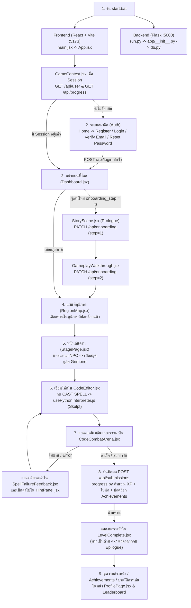

# คู่มือสรุปการทำงานของระบบและอธิบายการทำงานภายในของแต่ละไฟล์ (System Flow & File-by-File Guide)

**โครงงาน:** เกมส่งเสริมการเรียนรู้ภาษาไพธอน และพื้นฐานการประมวลผลภาพ "The Lost Spectrum"

---

## ส่วนที่ 1: ภาพรวมการทำงานของระบบตั้งแต่เริ่มจนจบ (End-to-End System Flow)

---

## ส่วนที่ 2: คำอธิบายการทำงานภายในของแต่ละไฟล์แบบละเอียด (File-by-File Mechanics)

### หมวดที่ 1: ไฟล์เริ่มต้นระบบและสคริปต์ (Root & Scripts)

#### 1. `start.bat`
- **หน้าที่หลัก:** สคริปต์ Batch สำหรับเปิดระบบทั้งหมดในคลิกเดียวบน Windows
- **การทำงานภายใน:**
  1. เข้าโฟลเดอร์ `backend/` แล้วเปิดหน้าต่าง Command Prompt รัน `venv\Scripts\activate && python run.py` เพื่อเปิด Flask API บนพอร์ต `5000`
  2. รอ 3 วินาที แล้วเข้าโฟลเดอร์ `frontend/` เปิดหน้าต่างรัน `npm.cmd run dev` เพื่อเปิด Vite Server บนพอร์ต `5173`
  3. รอ 4 วินาที แล้วสั่ง `start http://localhost:5173` เพื่อเปิดเว็บเบราว์เซอร์เข้าสู่ตัวเกมอัตโนมัติ

#### 2. `scripts/export-game-catalog.mjs`
- **หน้าที่หลัก:** สคริปต์ซิงค์ข้อมูลด่านจากฝั่ง Frontend ไปยังฝั่ง Backend และฐานข้อมูล
- **การทำงานภายใน:**
  - อ่านข้อมูลด่านจาก `frontend/src/features/stages/stageData.js`
  - แปลงข้อมูลด่านทั้งหมดให้อยู่ในรูป JSON มาตรฐานแล้วเขียนลงไฟล์ `backend/app/game/catalog.json`
  - สร้างคำสั่ง SQL `UPDATE / INSERT` สำหรับตาราง `public.levels` และ `public.achievements` ลงในไฟล์ `backend/seed_game_catalog.sql` เพื่อให้ข้อมูลด่านในฐานข้อมูลตรงกับ Frontend เสมอ

---

### หมวดที่ 2: ฝั่ง Backend (`backend/`)

#### 1. `backend/run.py`
- **หน้าที่หลัก:** จุดเริ่มต้นรันเซิร์ฟเวอร์ Flask
- **การทำงานภายใน:** นำออบเจกต์ `app` จาก `backend/app/__init__.py` มารันด้วย `app.run(debug=True, host='0.0.0.0', port=5000)`

#### 2. `backend/app/__init__.py`
- **หน้าที่หลัก:** ตั้งค่าโครงสร้างหลักของแอปพลิเคชัน Flask
- **การทำงานภายใน:**
  - โหลดตัวแปรสภาพแวดล้อมจากไฟล์ `backend/.env` ด้วย `load_dotenv()`
  - ตั้งค่า `CORS` ให้อนุญาตคำขอจาก React Frontend (`http://localhost:5173`) พร้อมเปิด `supports_credentials=True` เพื่อให้ส่ง Session Cookie ข้ามพอร์ตได้
  - ตั้งค่าเซิร์ฟเวอร์ส่งอีเมล SMTP (`smtp.gmail.com` พอร์ต `587` แบบ TLS) ให้กับ `Flask-Mail`
  - ลงทะเบียน Blueprint ทั้ง 3 ส่วน ได้แก่ `auth_bp` (ระบบสมาชิก), `main_bp` (หน้าหลักและเอกสาร API), และ `game_bp` (ระบบเกมและการบันทึกผล)

#### 3. `backend/app/db.py`
- **หน้าที่หลัก:** จัดการการเชื่อมต่อฐานข้อมูล PostgreSQL บน Supabase
- **การทำงานภายใน:**
  - อ่านค่า `DATABASE_URL` (หรือ `DB_HOST`, `DB_PASSWORD`) จาก `.env`
  - ฟังก์ชัน `get_db_connection()` สร้างการเชื่อมต่อด้วย `psycopg2.connect(..., cursor_factory=RealDictCursor)` เพื่อให้ผลลัพธ์จากการ Query ทุกครั้งกลับมาเป็น Dictionary ที่อ้างอิงด้วยชื่อคอลัมน์ได้ทันที (เช่น `user['player_id']`)

#### 4. `backend/app/auth/password_policy.py`
- **หน้าที่หลัก:** ตรวจสอบความถูกต้องของรหัสผ่านฝั่งเซิร์ฟเวอร์
- **การทำงานภายใน:**
  - ฟังก์ชัน `password_error(password)` ตรวจสอบว่ารหัสผ่านมีความยาว 8–72 ตัวอักษร, ไม่มีช่องว่าง, และประกอบด้วยตัวพิมพ์เล็ก (`a-z`), ตัวพิมพ์ใหญ่ (`A-Z`), และตัวเลข (`0-9`) ครบถ้วน หากไม่ครบจะคืนค่าข้อความแจ้งเตือนกลับไปให้ API

#### 5. `backend/app/auth/blueprint.py`, `email.py`, `routes.py`, และ `account_routes.py`
- **หน้าที่หลัก:** จัดการระบบสมาชิก การยืนยันอีเมล การรีเซ็ตรหัสผ่าน และการจัดการโปรไฟล์ทั้งหมด (แยกโมดูลตามหน้าที่)
- **การทำงานภายใน (แยกตามไฟล์และฟังก์ชัน):**
  - **`blueprint.py`:** ประกาศ `auth_bp = Blueprint('auth', __name__)` สำหรับให้ไฟล์ในหมวด `auth` ใช้ร่วมกัน
  - **`email.py`:**
    - `send_verification_email(email, token, username)`: สร้างอีเมล HTML ธีม Dark Fantasy สีทอง (`#b88949`) แนบลิงก์ `/verify-email/<token>` แล้วส่งผ่าน `mail.send()`
    - `send_password_reset_email(email, token, username)`: สร้างอีเมล HTML แนบลิงก์ไปยังหน้า React `/reset-password/<token>` (มีอายุ 1 ชั่วโมง)
  - **`routes.py` (การสมัคร ยืนยันอีเมล เข้าสู่ระบบ และรีเซ็ตรหัสผ่าน):**
    - `POST /api/signup` (`signup`):
      1. ตรวจค่าว่างและตรวจรหัสผ่านด้วย `password_error()`
      2. ตรวจในตาราง `players` ว่า `email` หรือ `username` ซ้ำหรือไม่
      3. ดึง `level_id` ของด่านแรก (`1-1`) จากตาราง `levels`
      4. สุ่ม `token = secrets.token_urlsafe(32)`, กำหนดวันหมดอายุ 24 ชั่วโมง และเข้ารหัสรหัสผ่านด้วย `generate_password_hash(..., method='pbkdf2:sha256')`
      5. `INSERT` ผู้เล่นลงตาราง `players` โดยตั้งค่าเริ่มต้น `is_verified = FALSE` พร้อมสร้างแถวเริ่มต้นในตาราง `game_progress` และ `player_stats` แล้วส่งอีเมลยืนยัน
    - `GET /verify-email/<token>` (`verify_email`):
      1. ค้นหาผู้เล่นจาก `verification_token` และตรวจว่าหมดอายุ (`token_expiry`) หรือยัง
      2. หากถูกต้อง จะ `UPDATE players SET is_verified = TRUE, verification_token = NULL, token_expiry = NULL` (ล้าง Token ทิ้งหลังใช้งานเสร็จเพื่อไม่ให้ใช้ซ้ำ) แล้วเรนเดอร์หน้า `verification_result.html`
    - `POST /api/resend-verification` (`resend_verification`): สุ่ม `verification_token` ใหม่ให้บัญชีที่ยังไม่ได้ยืนยันอีเมล แล้วส่งอีเมลยืนยันซ้ำอีกครั้ง
    - `POST /api/login` (`login`):
      1. ค้นหาผู้ใช้จาก `email` และตรวจรหัสผ่านด้วย `check_password_hash()`
      2. ตรวจว่า `user['is_verified']` เป็น `True` หรือยัง (ถ้ายังไม่ยืนยันจะคืนค่า `403` พร้อม `email_not_verified: True` เพื่อให้หน้า Login แสดงปุ่มส่งเมลซ้ำ)
      3. อัปเดตเวลา `last_login = NOW()` และบันทึก `player_id`, `username`, `email` ลงใน Flask `session`
    - `POST /api/forgot-password` & `POST /api/reset-password`: สร้าง `reset_token` ลงตาราง `players` ส่งลิงก์ทางเมล และเมื่อผู้ใช้ส่งรหัสผ่านใหม่พร้อม `token` มา จะตรวจสอบวันหมดอายุ อัปเดตรหัสผ่านใหม่ที่เข้ารหัสแล้ว และล้าง `reset_token` เป็น `NULL`
    - `POST /api/logout` (`logout`): ล้างข้อมูลใน Flask `session`
  - **`account_routes.py` (ข้อมูลบัญชี บทนำ โปรไฟล์ และการลบบัญชี):**
    - `GET /api/user` (`get_user`): อ่าน `session['player_id']` แล้วดึงข้อมูล `player_id, username, email, onboarding_step` ส่งกลับให้ Frontend
    - `PATCH /api/onboarding` (`advance_onboarding`): อัปเดตค่า `onboarding_step` (`1` = ดูฉากเปิดเรื่องแล้ว, `2` = ดูวิธีเล่นแล้ว) ด้วย `GREATEST(onboarding_step, %s)`
    - `PATCH /api/profile` (`update_profile`): ตรวจสอบว่าชื่อใหม่ไม่ซ้ำกับคนอื่น แล้วอัปเดต `username` ในตาราง `players`
    - `DELETE /api/account` (`delete_account`): ตรวจสอบรหัสผ่านปัจจุบันด้วย `check_password_hash()` หากถูกต้องจะลบข้อมูลใน `game_logs` และลบแถวใน `players` (ตารางอื่นๆ จะถูกลบตาม Foreign Key Cascade อัตโนมัติ) พร้อมล้าง Session

#### 6. `backend/app/game/routes.py`
- **หน้าที่หลัก:** เปิด REST API สำหรับระบบเกมทั้งหมด
- **การทำงานภายใน:**
  - `GET /api/leaderboard`: เรียก `read_leaderboard()` คืนค่ารายชื่อ Top 20 และอันดับของผู้เล่นปัจจุบัน
  - `GET /api/progress`: เรียก `read_progress()` คืนค่าความก้าวหน้า ด่านที่ผ่าน คะแนน XP และรายการ Achievements
  - `GET /api/profile/history`: คิวรีตาราง `code_submissions` ร่วมกับ `levels` โดยจัดกลุ่มตามด่าน (`GROUP BY stage_key`) เพื่อคำนวณจำนวนครั้งที่ส่งทั้งหมด (`COUNT(*)`), จำนวนครั้งที่ผ่าน, เวลาที่ผ่านครั้งแรก และเวลาที่ใช้รันเฉลี่ย (`AVG(s.runtime)`)
  - `POST /api/submissions`: รับข้อมูลการรันโค้ดจากหน้าด่าน ตรวจสอบความถูกต้องด้วย `validate_submission()` แล้วบันทึกลงฐานข้อมูลด้วย `save_submission()`

#### 7. `backend/app/game/progress.py`
- **หน้าที่หลัก:** หัวใจหลักในการคำนวณความก้าวหน้า คะแนน XP โบนัส และการปลดล็อกความสำเร็จ (Achievements)
- **การทำงานภายใน:**
  - โหลดไฟล์ `catalog.json` เก็บไว้ในตัวแปร `STAGES` (และตรวจเวลาแก้ไขไฟล์ `_stage_catalog()` เพื่อโหลดใหม่อัตโนมัติหากไฟล์เปลี่ยน)
  - `validate_submission(data)`: ตรวจสอบว่า `stage_key` มีอยู่จริง, `result` เป็น `'Success' | 'Fail' | 'Error'`, ความยาวโค้ดไม่เกิน 100,000 ตัวอักษร, `runtime` และ `hints_used` อยู่ในเกณฑ์ที่กำหนด และแปลง `submitted_at` เป็นเวลา UTC
  - `read_progress(cursor, player_id)`:
    1. ดึงด่านที่ผู้เล่นเคยส่งได้ผลลัพธ์ `'Success'` จาก `code_submissions` ร่วมกับ XP ที่บันทึกไว้ใน `game_logs`
    2. ดึงรายการความสำเร็จทั้งหมดจากตาราง `achievements` (`LEFT JOIN player_achievements`) เพื่อสร้างทั้งรายการที่ปลดล็อกแล้ว (`achievements`) และแค็ตตาล็อกความสำเร็จพร้อมตัวเลขความคืบหน้า (`achievementCatalog` เช่น `completedCount / requiredCount`)
    3. คำนวณจำนวนด่านที่ผ่านต่อเนื่องในแต่ละภูมิภาค (`stageProgress`) และภูมิภาคที่ผ่านครบทุกด่านแล้ว (`completedRegions`)
    4. ดึงคะแนนรวมสูงสุด (`highScore`) จากตาราง `game_progress`
  - `save_submission(cursor, player_id, data)`:
    1. ล็อกแถวผู้เล่นชั่วคราว (`SELECT player_id FROM players WHERE player_id = %s FOR UPDATE`) เพื่อป้องกันการส่งซ้ำพร้อมกัน
    2. ตรวจสอบจาก `code_submissions` ว่าผู้เล่นเคยผ่านด่านนี้มาก่อนหรือไม่ (`prior['wins'] == 0`)
    3. **การคำนวณ XP:** ให้คะแนนเฉพาะการผ่านด่านครั้งแรก (`first_clear`) โดยนำ `base_xp` ของด่านมาคูณโบนัส:
       - ถ้าผ่านในการส่งครั้งแรก (`first_attempt`): ได้โบนัส `+50%` (`First Attempt Bonus`)
       - ถ้าไม่กดใช้คำใบ้เลย (`hints_used == 0`): ได้โบนัส `+30%` (`No Hints Used`)
    4. บันทึกแถวใหม่ลงตาราง `code_submissions` และบันทึกรายละเอียด XP/โบนัสลงตาราง `game_logs`
    5. อัปเดตด่านถัดไปและบวกคะแนน `high_score` สะสมลงในตาราง `game_progress` และ `player_stats`
    6. ตรวจสอบเงื่อนไขความสำเร็จ (ผ่านด่านแรก `1-1`, ผ่านครบแต่ละภูมิภาค `region:1..4`, หรือผ่านครบทั้ง 25 ด่าน `all`) แล้ว `INSERT INTO player_achievements ... ON CONFLICT DO NOTHING`

#### 8. `backend/app/game/leaderboard.py`
- **หน้าที่หลัก:** คำนวณอันดับผู้เล่นบนกระดานอันดับ
- **การทำงานภายใน:**
  - ฟังก์ชัน `read_leaderboard(cursor, player_id)` ใช้ SQL CTE (`WITH first_wins AS (...), totals AS (...), scores AS (...), ranked AS (...)`)
  - จัดอันดับด้วย `ROW_NUMBER() OVER (ORDER BY score DESC, completed_stages DESC, reached_at ASC, player_id ASC)` (เรียงตามคะแนน XP มากสุด -> จำนวนด่านที่ผ่านมากสุด -> เวลาที่ไปถึงคะแนนนั้นเร็วสุด)
  - คืนค่า `entries` (20 อันดับแรก) และ `me` (ข้อมูลอันดับของผู้เล่นที่กำลังล็อกอินอยู่ แม้จะอยู่นอก Top 20)

#### 9. `backend/app/api_docs.py` & `backend/app/main/routes.py`
- **หน้าที่หลัก:** จัดการหน้าเอกสาร API (Swagger UI)
- **การทำงานภายใน:** `api_docs.py` เก็บโครงสร้าง JSON ของ OpenAPI 3.0.3 ทั้งหมด ส่วน `main/routes.py` เปิด Endpoint `/api/openapi.json` และ `/api/docs` เพื่อแสดงหน้าเว็บ Swagger UI ให้ทดสอบยิง API ได้จากเบราว์เซอร์

---

### หมวดที่ 3: ฝั่ง Frontend — โครงสร้างหลักและ Context (`frontend/src/`)

#### 1. `frontend/src/main.jsx` & `frontend/src/App.jsx`
- **หน้าที่หลัก:** จุดเริ่มต้นของ React และตัวจัดการเส้นทางหน้าเว็บ (`Router`)
- **การทำงานภายในของ `App.jsx`:**
  - ห่อหุ้มแอปทั้งหมดด้วย `<LanguageProvider>` (ระบบสลับภาษา) และ `<GameProvider>` (ข้อมูลผู้เล่นและความก้าวหน้า)
  - สร้างคอมโพเนนต์ `ProtectedRoute` ที่ตรวจสอบค่า `user` และ `loading` จาก `useGame()` หากยังไม่ได้ล็อกอินจะ Redirect ไปหน้า `/login` ทันที
  - กำหนด Route ทั้งหมด: `/`, `/login`, `/register`, `/forgot-password`, `/reset-password/:token`, `/dashboard`, `/profile`, `/region/:regionId`, และ `/region/:regionId/stage/:stageId`

#### 2. `frontend/src/shared/api/axios.js`
- **หน้าที่หลัก:** ตัวกลางสำหรับส่ง HTTP Request ไปหา Flask Backend
- **การทำงานภายใน:** สร้าง Axios instance ที่ตั้งค่า `timeout: 20000` และ `withCredentials: true` เพื่อให้เบราว์เซอร์แนบ Flask Session Cookie ไปกับทุก Request อัตโนมัติ

#### 3. `frontend/src/shared/context/GameContext.jsx`
- **หน้าที่หลัก:** จัดการสถานะส่วนกลางของผู้เล่นและความก้าวหน้าในเกมทั้งหมด
- **การทำงานภายใน:**
  - `checkSession()`: ยิง `GET /api/user` และ `GET /api/progress` พร้อมกันเมื่อเปิดเว็บ แล้วนำข้อมูลบัญชีและความก้าวหน้ามารวมไว้ใน state `user`
  - `login(email, password)`: ยิง `POST /api/login` หากสำเร็จจะยิง `GET /api/progress` ต่อทันทีเพื่อโหลดด่านที่ผ่านและ XP เข้าสู่ `user` (หากติดสถานะยังไม่ยืนยันอีเมล `403` จะส่ง `emailNotVerified: true` กลับไปให้หน้า `Login.jsx`)
  - `logout()`: ยิง `POST /api/logout` และล้างค่า `user` เป็น `null`
  - `deleteAccount(password)`: ยิง `DELETE /api/account` พร้อมรหัสผ่าน ล้างข้อมูลใน `localStorage` ของผู้เล่นคนนั้น และล้าง state `user`
  - `saveAttempt(attempt)`: ยิง `POST /api/submissions` เมื่อรันโค้ดในด่านเสร็จ แล้วนำ `res.data.progress` ล่าสุดมาอัปเดตใส่ `user` state ทันทีโดยไม่ต้องโหลดหน้าใหม่
  - `updateProfile(username)` & `advanceOnboarding(step)`: ยิง `PATCH /api/profile` และ `PATCH /api/onboarding` พร้อมอัปเดต state `user`

#### 4. `frontend/src/shared/i18n/LanguageContext.jsx`, `useLanguage.js`, และ `frontend/src/features/stages/stageThai.js`
- **หน้าที่หลัก:** ระบบแปลและสลับภาษาไทย/อังกฤษทั้งเว็บไซต์
- **การทำงานภายใน:**
  - `LanguageContext.jsx`: เก็บค่าภาษาปัจจุบัน (`'en'` หรือ `'th'`) ไว้ใน `localStorage` (`lost_spectrum_language`) และส่งค่า `language`, `setLanguage`, `isThai` ให้ทุกคอมโพเนนต์เรียกใช้ผ่าน Hook `useLanguage()`
  - `stageThai.js`: เก็บพจนานุกรมคำแปลภาษาไทยของทั้ง 4 ภูมิภาค และทั้ง 25 ด่าน พร้อมฟังก์ชัน `localRegion()`, `localStage()`, `localStageData()` ที่จะแทนที่ข้อความภาษาอังกฤษด้วยภาษาไทยทันทีเมื่อ `isThai === true`

---

### หมวดที่ 4: ฝั่ง Frontend — ระบบสมาชิก (`frontend/src/features/auth/`)

#### 1. `Home.jsx`
- **หน้าที่หลัก:** หน้าต้อนรับแรกสุด (`/`) แสดงชื่อเกมและปุ่ม `ENTER THE REALM` เพื่อนำเข้าสู่หน้า `/login`

#### 2. `Register.jsx`, `PasswordChecklist.jsx`, และ `passwordPolicy.js`
- **หน้าที่หลัก:** หน้าสมัครสมาชิกและตัวตรวจเงื่อนไขรหัสผ่าน
- **การทำงานภายใน:**
  - ขณะที่ผู้ใช้พิมพ์รหัสผ่าน `PasswordChecklist.jsx` จะเรียก `evaluatePassword(password)` จาก `passwordPolicy.js` เพื่อตรวจเงื่อนไข 5 ข้อ (ความยาวอย่างน้อย 8 ตัว, มีตัวพิมพ์เล็ก, พิมพ์ใหญ่, ตัวเลข, ไม่มีช่องว่าง) และเปลี่ยนสีไอคอนเป็นสีเขียวทันทีที่ผ่านแต่ละข้อ
  - เมื่อกดสมัคร `handleSubmit` จะตรวจสอบรหัสผ่านอีกครั้งและยิง `POST /api/signup` เมื่อสำเร็จจะสลับการ์ดเป็นข้อความแจ้งให้ไปกดลิงก์ยืนยันในอีเมลก่อนเข้าสู่ระบบ

#### 3. `Login.jsx`
- **หน้าที่หลัก:** หน้าเข้าสู่ระบบ (`/login`)
- **การทำงานภายใน:**
  - เรียก `login(email, password)` จาก `GameContext` หากสำเร็จจะสั่ง `navigate('/dashboard')`
  - หาก Backend ตอบกลับว่ายังไม่ได้ยืนยันอีเมล (`result.emailNotVerified === true`) จะแสดงปุ่ม `RESEND VERIFICATION EMAIL` เพื่อให้ผู้ใช้กดยิง `POST /api/resend-verification` ขอรับลิงก์ใหม่ได้จากหน้า Login ทันที

#### 4. `ForgotPassword.jsx` & `ResetPassword.jsx`
- **หน้าที่หลัก:** หน้าขอรีเซ็ตรหัสผ่านและหน้าตั้งรหัสผ่านใหม่
- **การทำงานภายใน:**
  - `ForgotPassword.jsx` ส่งอีเมลไปที่ `POST /api/forgot-password` แล้วแสดงข้อความยืนยันสีเขียวบนหน้าจอ
  - `ResetPassword.jsx` อ่านค่า `token` จาก URL (`useParams()`) ตรวจความแข็งแรงของรหัสผ่านใหม่ด้วย `isValidPassword()` แล้วยิง `POST /api/reset-password` เมื่อสำเร็จจะพากลับไปหน้า `/login` อัตโนมัติ

---

### หมวดที่ 5: ฝั่ง Frontend — แผนที่โลก เนื้อเรื่อง และข้อมูลด่าน (`world/` & `stages/`)

#### 1. `Dashboard.jsx`
- **หน้าที่หลัก:** หน้าศูนย์กลางของเกม (`/dashboard`) แสดงแผนที่โลก กระดานอันดับ และควบคุมลำดับบทนำของผู้เล่นใหม่
- **การทำงานภายใน:**
  - **การตรวจสถานะบทนำอัตโนมัติ:** ตรวจค่า `user.onboarding_step` หากเป็น `0` และยังไม่เคยผ่านด่านใดเลย จะเปิด `<StoryScene scene="prologue" />` อัตโนมัติ เมื่อปิดฉากเนื้อเรื่องจะเรียก `advanceOnboarding(1)` แล้วเปิด `<GameplayWalkthrough />` ต่อทันที เมื่อดูวิธีเล่นจบจะเรียก `advanceOnboarding(2)` และพาไปหน้า `/region/1`
  - **การล็อกภูมิภาค (`getRegionStatus`):** ภูมิภาคที่ 1 เปิดให้เล่นเสมอ ส่วนภูมิภาคที่ `2, 3, 4` จะตรวจจาก `user.completedRegions` ว่าผ่านภูมิภาคก่อนหน้า (`regionId - 1`) ครบทุกด่านหรือยัง ถ้ายังไม่ครบจะแสดงสถานะ `locked` (รูปแม่กุญแจและกดเข้าไม่ได้)
  - **กระดานอันดับ (Leaderboard):** เมื่อเปิดหน้าจะยิง `GET /api/leaderboard` เพื่อนำรายชื่อผู้เล่น Top 20 และอันดับของตัวเองมาแสดงในแถบด้านขวา
  - **หน้าต่างเรื่องราวโลก (`World Legends`):** เมื่อกดปุ่ม `VIEW LEGENDS / ดูเรื่องราวโลก` จะเปิด Modal แสดงรายชื่อด่านและแนวคิด Python ที่สอนในแต่ละภูมิภาค พร้อมปุ่มกดดูฉากเปิดเรื่อง (`Replay Opening`) และฉากจบ (`Replay Ending` เมื่อผ่านด่าน `4-7` แล้ว) ซ้ำได้ตลอดเวลา

#### 2. `StoryScene.jsx`
- **หน้าที่หลัก:** แสดงฉากเนื้อเรื่องเปิดเกม (`prologue`) และฉากจบเกม (`epilogue`)
- **การทำงานภายใน:**
  - ดึงบทบรรยายจาก `STORY_SCENES[scene]` ในไฟล์ `storyScenes.js` ตามภาษาปัจจุบัน (`th` หรือ `en`)
  - แทนที่ตัวแปร `{name}` ในเนื้อเรื่องด้วยชื่อของผู้เล่นจริง (`playerName`)
  - หากเป็นฉากจบ (`scene === 'epilogue'`) จะแสดงภาพแผนที่โลกที่ค่อยๆ คืนสีสันกลับมา พร้อมปุ่มกดไปต่อและรองรับการกดปุ่ม `Escape` เพื่อปิดหน้าต่าง

#### 3. `GameplayWalkthrough.jsx`
- **หน้าที่หลัก:** หน้าต่างแนะนำวิธีเล่น 4 ขั้นตอนพร้อมภาพไฮไลต์จุดสำคัญบนหน้าจอ
- **การทำงานภายใน:**
  - เก็บข้อมูลคำอธิบาย 4 ขั้นตอนไว้ใน `STEPS` (ทั้งภาษาไทยและอังกฤษ)
  - คอมโพเนนต์ย่อย `ScreenshotGuide` ใช้ภาพหน้าจอจริง (`map-guide.jpeg` และ `stage-guide.jpeg`) ซ้อนทับด้วย SVG `<mask>` เพื่อเจาะช่องสว่าง (Spotlight) ล้อมกรอบสีทองตรงปุ่มที่กำลังอธิบายในแต่ละขั้นตอน (เช่น ปุ่มเลือกบท, ช่องโจทย์และโค้ด, ปุ่มคัมภีร์เวท, และปุ่มรันโค้ด)

#### 4. `RegionMap.jsx`
- **หน้าที่หลัก:** หน้าแผนที่ย่อยของแต่ละภูมิภาค (`/region/:regionId`)
- **การทำงานภายใน:**
  - ดึงข้อมูลภูมิภาคจาก `REGIONS[regionId]` และตรวจสถานะของแต่ละด่าน (`getStageStatus`) จาก `user.completedStages`
  - แสดงผลเป็นเส้นไทม์ไลน์เรียงตามลำดับด่าน หากด่านใดผ่านแล้วจะแสดงเครื่องหมายถูกสีเขียว (`Completed / ผ่านแล้ว`) เมื่อคลิกที่การ์ดด่านจะสั่ง `navigate('/region/${regionId}/stage/${stage.id}')`

#### 5. `stageData.js`, `chapterOneBasics.js`, `chapterTwoStages.js`, `chapterThreeFourStages.js`, `stageStories.js`, `stageGuides.js`, `grimoireTh.js`
- **หน้าที่หลัก:** คลังข้อมูลหลักสูตรทั้ง 25 ด่าน
- **การทำงานภายใน:**
  - `stageData.js` รวมข้อมูลด่านจากทุกบทเข้าด้วยกัน แล้วส่งผ่านฟังก์ชัน `withStageStory()` จาก `stageStories.js` เพื่อผูกบทสนทนาของ NPC ประจำบทเข้ากับทุกด่าน
  - ในแต่ละด่านจะกำหนด: `title`, `stageType` (`lesson`, `challenge`, `boss`), `xpReward`, `arena` (ขนาดตาราง, จุดเกิด `spawn`, สิ่งกีดขวาง `obstacles`, เป้าหมาย `altar` / `flasks` / `colorTargets` / `gate`), `initialCode`, `visionChecks` (โค้ดทดสอบความถูกต้องของฟังก์ชัน Python), `hints` (คำใบ้ 3 ระดับ), และ `grimoire` (เนื้อหาสมุดคู่มือ)

---

### หมวดที่ 6: ฝั่ง Frontend — ห้องปฏิบัติการเขียนโค้ดและสนามประลอง (`frontend/src/features/gameplay/`)

#### 1. `StagePage.jsx`, `StageStoryIntro.jsx`, `StageTypeContent.jsx`, `arenaActions.js`, และ `storyCharacters.js`
- **หน้าที่หลัก:** คอมโพเนนต์หลักและโมดูลย่อยที่ควบคุมการเล่นในแต่ละด่านตั้งแต่ต้นจนจบ (`/region/:regionId/stage/:stageId`)
- **การทำงานภายใน:**
  1. **ช่วงบทสนทนา (`storyPhase === 'intro'` — `StageStoryIntro.jsx` & `storyCharacters.js`):**
     - `storyCharacters.js` กำหนดตารางจับคู่สไปรต์ ฉายา และไอคอนของตัวละคร NPC ทั้งหมด (`Eldrin`, `Prisma`, `Loremaster Vane`, `Cave Warden`, `Rune Keeper`, `Krakk`)
     - `StageStoryIntro.jsx` แสดงฉากหลังและตัวละครผู้เล่นคู่กับ NPC ประจำด่าน (`WizardSprite`) พร้อมข้อความสนทนาแบบพิมพ์ดีด (`Typewriter effect`) เมื่ออ่านครบหรือกดปุ่ม `Skip` จะเรียก `handleEnterTower()` เพื่อเลื่อนเข้าสู่หน้า IDE และเปิดสมุดคู่มือ `Grimoire` อัตโนมัติ
  2. **ช่วงเขียนและรันโค้ด (`storyPhase === 'ide'` — `StagePage.jsx`, `StageTypeContent.jsx`, & `arenaActions.js`):**
     - `StageTypeContent.jsx` ตรวจสอบรูปแบบของด่าน (`guided`, `debug`, `puzzle` หรือหน้า IDE มาตรฐาน)
     - เมื่อผู้เล่นกดปุ่ม **CAST SPELL** (`handleRun` ใน `StagePage.jsx`):
       - บันทึกเวลาเริ่มต้น (`performance.now()`) และเวลาส่ง (`new Date().toISOString()`)
       - หากเป็นด่านบอส `4-7` จะเริ่มเดินนาฬิกาจับเวลาถอยหลัง 5 นาที (`BOSS_TIME_LIMIT_SECONDS = 300`) ซึ่งจะนับเวลาเฉพาะตอนที่กำลังรันคาถาและหยุดพักให้ขณะแก้ไขโค้ด
       - เรียก `createArenaRunCallbacks()` จาก `arenaActions.js` เพื่อดักจับคำสั่งที่ผู้เล่นเรียกใน Python (`hero.move_right`, `hero.pick_up`, `hero.put_in`, `hero.cast_color`, `print`) แล้วแปลงเป็นรายการคำสั่งใส่ลงในอาร์เรย์ `actions`
       - หากด่านนั้นมี `visionChecks` (ใน Region 3 และ 4) จะนำโค้ด `visionChecks` ไปต่อท้ายโค้ดของผู้เล่นเพื่อตรวจว่าฟังก์ชัน `transform(pixels)` ทำงานถูกต้องกับชุดข้อมูลทดสอบหรือไม่
       - เรียก `runCode()` จาก `usePythonInterpreter.js`
  3. **การส่งคิวคำสั่งและบันทึกผล (`finishAttempt` & `persistAttempt`):**
     - เมื่อ Skulpt รันโค้ดจบโดยไม่มี Syntax Error จะส่งอาร์เรย์ `actions` เข้าสู่ `arenaActionQueue` เพื่อให้ `CodeCombatArena` เล่นแอนิเมชันทีละขั้น
     - เมื่อ `CodeCombatArena` เล่นแอนิเมชันจบและแจ้งผลว่าผ่านหรือไม่ผ่าน (`handleArenaExecutionFinish`) ฟังก์ชัน `finishAttempt()` จะถูกเรียกเพื่อส่งข้อมูล (`stage_key`, `code`, `result`, `runtime`, `submitted_at`, `hints_used`) ไปบันทึกที่ Backend ผ่าน `saveAttempt()`
     - หากผลลัพธ์เป็น `'Success'` จะเรียก `handleLevelComplete()` เพื่อคำนวณ XP/เลเวลด้วย `awardXP()` และเปิดหน้าสรุปผล `<LevelComplete />` (หรือเปิดฉากจบ `<StoryScene scene="epilogue" />` หากเป็นด่าน `4-7`)

#### 2. `usePythonInterpreter.js`
- **หน้าที่หลัก:** ตัวเชื่อมระหว่าง React กับเอนจินแปลภาษา Python (**Skulpt**) บนเบราว์เซอร์
- **การทำงานภายใน:**
  - ตั้งค่า `window.Sk.configure({ output, read, execLimit: 5000 })` (จำกัดเวลาประมวลผล 5 วินาทีเพื่อป้องกัน Infinite Loop เช่น `while True:` ค้างเบราว์เซอร์)
  - สร้างโมดูล Python จำลองชื่อ `hero` (`window.Sk.builtins.hero = heroModule`) โดยใช้ `window.Sk.ffi.remapToJs` แปลงพารามิเตอร์ที่ผู้เล่นส่งมาจากโค้ด Python ให้กลายเป็นค่า JavaScript แล้วไปเรียก Callback ของ `StagePage.jsx`
  - รันโค้ด Python แบบ Asynchronous ด้วย `window.Sk.misceval.asyncToPromise(() => window.Sk.importMainWithBody("<stdin>", false, code, true))`
  - หากเกิด Exception ในโค้ด Python จะจับ Error แปลงเป็นข้อความและเรียก `heroCallbacks.__onError(errStr)`

#### 3. `CodeCombatArena/CodeCombatArena.jsx` & `colorTargets.js`
- **หน้าที่หลัก:** สนามประลอง 2 มิติที่แสดงผลแอนิเมชันและตรวจเงื่อนไขความสำเร็จของด่าน
- **การทำงานภายใน:**
  - คำนวณขนาดตาราง (`cols * TILE_SIZE`, `rows * TILE_SIZE`) และย่อ/ขยายอัตโนมัติด้วย `ResizeObserver` ให้พอดีกับหน้าจอเสมอ
  - เมื่อได้รับ `actionQueue` และ `isExecuting === true`:
    - ใช้ `setTimeout` ดึงคำสั่งออกจากคิวทีละคำสั่งตามความเร็วที่เลือก (`1x` = 350ms, `2x` = 180ms, `3x` = 90ms)
    - **คำสั่งเดิน (`move`):** คำนวณพิกัด `(nextX, nextY)` ตรวจว่าออกนอกขอบตาราง ชนสิ่งกีดขวาง (`obstacles`) หรือเหยียบกับดักเงา (`hazards`) หรือไม่ ถ้าชนจะหยุดทันทีและส่งสาเหตุความล้มเหลวกลับไปให้ `onExecutionFinish(false, failure)`
    - **คำสั่งเก็บและใส่ขวด (`pick_up` / `put_in`):** ตรวจว่ายืนอยู่บนไอเทมหรือไม่ และตอนใส่ขวด (`put_in`) จะตรวจว่าชนิดข้อมูลของไอเทม (`str`, `int`, `float`, `bool`) ตรงกับชนิดของขวดหรือไม่
    - **คำสั่งร่ายสี (`cast_color`):** ตรวจว่าค่า `(r, g, b)` เป็นจำนวนเต็มในช่วง `0..255` (`isValidRgb`) และหาว่ามีเป้าหมายสี (`colorTargets`) อยู่บนช่องเดียวกันหรือช่องติดกันหรือไม่ แล้วเปลี่ยนสีของเป้าหมายนั้นบนหน้าจอทันที
    - **คำสั่งพูด (`print`):** แสดงกล่องข้อความคำพูดเหนือหัวตัวละคร และหากยืนอยู่ที่แท่นบูชา (`altar`) หรือประตู (`gate`) ที่ตรงกับคำสำคัญ (`keyword`) จะปลดล็อกแท่นบูชา/ประตูนั้น
  - เมื่อรันครบทุกคำสั่งในคิว จะเรียก `checkVictory()` เพื่อตรวจว่าเป้าหมายทั้งหมดของด่าน (ขวดครบทุกใบ, เป้าหมายสี RGB ตรงกับ `targetRgb` ทุกจุดด้วย `areColorTargetsMatched()`, หรือเดินถึงประตูบอสแล้ว) สำเร็จครบถ้วนหรือไม่

#### 4. `spellFeedback.js` & `SpellFailureFeedback.jsx`
- **หน้าที่หลัก:** ระบบวิเคราะห์สาเหตุที่รันโค้ดไม่ผ่านและแสดงคำแนะนำภาษาคน (ทั้งไทยและอังกฤษ)
- **การทำงานภายใน:**
  - `pythonFailure(error)`: วิเคราะห์ข้อความ Error จาก Skulpt แยกเป็นประเภท `syntax`, `name`, `indent`, `type`, หรือ `assertion` (กรณีไม่ผ่าน Test Case แถวพิกเซล)
  - `colorFailure(targets, states)`: เปรียบเทียบค่าสี RGB ที่ผู้เล่นร่ายใส่แต่ละวัตถุกับค่า `targetRgb` ที่ถูกต้อง แล้วระบุให้ชัดเจนว่าวัตถุไหนที่ช่องสี `R`, `G`, หรือ `B` ยังคำนวณผิดอยู่และได้ค่าเท่าไหร่
  - `spellFeedback(failure, isThai)`: แปลงรหัสความล้มเหลวทั้งหมดให้เป็นข้อความ 2 ส่วน คือ **สิ่งที่เกิดขึ้น (`observed`)** และ **คำแนะนำสิ่งที่ควรลองแก้ต่อไป (`nextStep`)** เพื่อแสดงในกล่องแจ้งเตือนของ `SpellFailureFeedback.jsx`

#### 5. `HintPanel.jsx`, `Grimoire.jsx`, `SpellBook.jsx`, และ `LevelComplete.jsx`
- **หน้าที่หลัก:** เครื่องมือช่วยเหลือการเรียนรู้และหน้าสรุปผลหลังจบด่าน
- **การทำงานภายใน:**
  - `HintPanel.jsx`: คำนวณระดับคำใบ้ที่เปิดให้ดูจากจำนวนครั้งที่ลองผิด (`Math.floor(attemptCount / 2)`) หรือเมื่อผู้เล่นกดปุ่มขอคำใบ้เพิ่ม (`handleRequestMore`) ซึ่งจะเรียก `onRequestHint()` เพื่อบวกตัวแปร `hintsUsed` ใน `StagePage.jsx`
  - `Grimoire.jsx`: แสดงสมุดคู่มือประจำด่าน แบ่งเป็น 2 แท็บ คือ **วิธีเล่นด่านนี้ (`Quick Guide`)** ที่ดึงจาก `stageGuides.js` (บอกเป้าหมาย แนวคิด และตัวอย่างสั้นๆ) และ **ข้อมูลอ้างอิง (`Reference`)** ที่แสดงเป็นหน้าหนังสือซ้าย-ขวาพร้อมตัวอย่างโค้ดและวงล้อสี
  - `SpellBook.jsx`: แสดงตารางคาถาทั้ง 12 คาถาจาก `SPELLS` คาถาที่อยู่ใน `unlockedSpells` จะแสดงสีสันและกดคลิกเพื่อเปิด Modal ดูคำอธิบาย ตัวอย่างโค้ด และวิธีนำไปใช้ในเกมได้
  - `LevelComplete.jsx`: แสดงผลเมื่อผ่านด่าน โดยรับ `completionResult` มาแสดงรายละเอียดคะแนน `Base XP`, รายการโบนัสที่ได้ (`First Attempt Bonus`, `No Hints Used`), การแจ้งเตือน `LEVEL UP!` เมื่อเลเวลพ่อมดเพิ่มขึ้น, การ์ดคาถาหรือชุดคลุมใหม่ที่ปลดล็อก และปุ่ม `Replay Level` หรือ `Continue Journey`

---

### หมวดที่ 7: ฝั่ง Frontend — ระบบตัวละครและหน้าโปรไฟล์ (`frontend/src/features/character/`)

#### 1. `characterData.js` & `useCharacterProgression.js`
- **หน้าที่หลัก:** กำหนดตารางเลเวล คาถา ชุดคลุม และคำนวณความก้าวหน้าของตัวละคร
- **การทำงานภายใน:**
  - `characterData.js`: เก็บค่าคงที่ `CHARACTER_LEVELS` (เลเวล 1 `Novice` ที่ 0 XP ไปจนถึงเลเวล 8 `Spectrum Lord` ที่ 12,000 XP), `SPELLS` (คาถา 12 บทที่ผูกกับด่านที่ปลดล็อก `unlockStage`), `OUTFITS` และฟังก์ชันคำนวณเลเวล `calculateLevel(totalXP)` / `getLevelProgress(totalXP)`
  - `useCharacterProgression.js`: ดึง `user.completedStages` และ `user.highScore` จาก `GameContext` มาคำนวณเลเวลปัจจุบัน รายการคาถาที่ปลดล็อก (`unlockedSpells`) และแนวคิดที่ได้เรียนรู้แล้ว (`conceptsMastered`) พร้อมฟังก์ชัน `awardXP()` ที่ใช้ตรวจสอบตอนจบด่านว่าผู้เล่นเลเวลอัปหรือปลดล็อกคาถา/ชุดคลุมใหม่ในด่านนั้นหรือไม่

#### 2. `WizardSprite.jsx` & `spriteCrops.js`
- **หน้าที่หลัก:** แสดงตัวละครสไปรต์ 2 มิติพร้อมแอนิเมชันและเอฟเฟกต์แสง
- **การทำงานภายใน:**
  - `spriteCrops.js` กำหนดพิกัดการตัดภาพสไปรต์ (Crop Box) ของตัวละครแต่ละตัว (`hero`, `eldrin`, `prisma`, `vane`, `cave-warden`, `rune-keeper`, `krakk`) ในแต่ละท่าทาง (`idle`, `thinking`, `casting`, `success`, `confused`)
  - `WizardSprite.jsx` นำพิกัดเหล่านั้นมาเรนเดอร์เป็นภาพตัวละครพร้อมละอองเวทมนตร์และเงาด้านล่าง

#### 3. `ProfilePage.jsx` & `ProfileNameForm.jsx`
- **หน้าที่หลัก:** หน้าโปรไฟล์ผู้เล่น (`/profile`)
- **การทำงานภายใน:**
  - แสดงข้อมูลสรุปของผู้เล่น (ฉายาพ่อมด, ชื่อผู้ใช้, เลเวล, คะแนน XP และหลอดความคืบหน้าไปสู่เลเวลถัดไป)
  - `ProfileNameForm.jsx`: ฟอร์มแก้ไขชื่อผู้เล่นที่เรียก `updateProfile(name)` ไปยัง `PATCH /api/profile`
  - **หมวดความสำเร็จ (`Achievements`):** อ่าน `user.achievementCatalog` มาแสดงเป็นการ์ดความสำเร็จทั้ง 6 รายการ แยกสถานะ `Unlocked / ปลดล็อกแล้ว` (พร้อมวันที่ได้รับ) และสถานะยังไม่ปลดล็อก (แสดงความคืบหน้าจำนวนด่าน `completedCount/requiredCount`)
  - **หมวดสิ่งที่สะสมได้ (`Unlocked spells` & `Mastered concepts`):** แสดงรายการคาถาและแนวคิด Python ที่ปลดล็อกแล้ว
  - **หมวดประวัติการเล่นรายด่าน (`Stage history`):** ยิง `GET /api/profile/history` ตอนเปิดหน้าเพื่อนำประวัติการส่งโค้ดของแต่ละด่าน (จำนวนครั้งที่ลอง, วันที่ผ่าน, XP ที่ได้, เวลาเฉลี่ยในการรัน) มาแสดงพร้อมปุ่มลัดให้กดกลับไปเล่นซ้ำ (`Replay stage`) หรือเล่นต่อ (`Continue stage`) ได้ทันที
  - **การลบบัญชีถาวร (`Delete account`):** เมื่อกดปุ่มลบบัญชีจะเปิด Modal ให้กรอกรหัสผ่านปัจจุบันเพื่อยืนยัน แล้วเรียก `deleteAccount(deletePassword)` เพื่อลบบัญชีและพากลับไปหน้า `/login`

