# คู่มือจัดทำภาพประกอบส่วนติดต่อผู้ใช้ (UI) สำหรับรายงานโครงงาน The Lost Spectrum

โฟลเดอร์นี้ (`documents/ui_screenshots/`) ใช้สำหรับเก็บรูปภาพหน้าจอ (Screenshots) ของระบบควบคู่กับชื่อภาพใต้รูปและคำอธิบายประกอบ เพื่อนำไปวางในรายงานโครงงานหรือบทที่ 4 (ผลการดำเนินงาน)

---

## 📌 โครงสร้างชื่อไฟล์รูปภาพในโฟลเดอร์ `documents/ui_screenshots/`

| ลำดับ | ชื่อไฟล์รูปภาพ | ชื่อใต้ภาพ (Caption) | URL / ตำแหน่งที่กดในเว็บ |
| :---: | --- | --- | --- |
| 1 | `01_home_page.png` | **ภาพที่ 1 หน้าแรกของเว็บแอปพลิเคชัน** | `http://localhost:5173/` |
| 2 | `02_register_page.png` | **ภาพที่ 2 หน้าสมัครสมาชิก** | `http://localhost:5173/register` |
| 3 | `03_login_page.png` | **ภาพที่ 3 หน้าเข้าสู่ระบบ** | `http://localhost:5173/login` |
| 4 | `04_forgot_password_page.png` | **ภาพที่ 4 หน้าขอรีเซ็ตรหัสผ่าน** | `http://localhost:5173/forgot-password` |
| 5 | `05_prologue_story.png` | **ภาพที่ 5 หน้าจอฉากเนื้อเรื่องเปิดเกม** | หน้า `/dashboard` (กดปุ่ม `ดูเรื่องราวโลก` → `ดูตอนเปิดเรื่อง`) |
| 6 | `06_gameplay_walkthrough.png` | **ภาพที่ 6 หน้าจอแนะนำวิธีการเล่นครั้งแรก** | หน้า `/dashboard` (กดปุ่ม `วิธีเล่น / Tutorial` มุมซ้ายล่าง) |
| 7 | `07_dashboard_world_map.png` | **ภาพที่ 7 หน้าแผนที่โลกและกระดานอันดับผู้เล่น** | `http://localhost:5173/dashboard` |
| 8 | `08_world_legends_modal.png` | **ภาพที่ 8 หน้าต่างเรื่องราวของโลกและสารบัญด่าน** | หน้า `/dashboard` (กดปุ่ม `ดูเรื่องราวโลก / VIEW LEGENDS`) |
| 9 | `09_region_map.png` | **ภาพที่ 9 หน้าแผนที่ภูมิภาคและลำดับด่าน** | `http://localhost:5173/region/1` |
| 10 | `10_stage_story_intro.png` | **ภาพที่ 10 หน้าจอบทสนทนาตัวละครก่อนเริ่มด่าน** | `http://localhost:5173/region/1/stage/1` (ช่วงบทสนทนา NPC) |
| 11 | `11_grimoire_modal.png` | **ภาพที่ 11 หน้าต่างสมุดคู่มือการเรียนรู้ประจำด่าน (Grimoire)** | หน้าด่าน (กดปุ่ม `คาถา / Spells` บนแถบเมนูบน) |
| 12 | `12_stage_ide_arena.png` | **ภาพที่ 12 หน้าจอเล่นเกม สนามประลอง 2 มิติ และส่วนแก้ไขโค้ด** | `http://localhost:5173/region/1/stage/1` (ปิดหน้าต่าง Grimoire) |
| 13 | `13_hint_and_feedback.png` | **ภาพที่ 13 ส่วนแสดงคำใบ้ตามลำดับขั้นและการแจ้งเตือนข้อผิดพลาด** | หน้าด่าน (เมื่อรันโค้ดผิดพลาด แถบคำใบ้และกล่องแจ้งเตือนจะปรากฏ) |
| 14 | `14_spell_book_modal.png` | **ภาพที่ 14 หน้าต่างหนังสือคาถาที่ปลดล็อกแล้ว (Spell Book)** | หน้าด่าน (กดปุ่ม `หนังสือคาถา / Spell Book` บนแถบเมนูบน) |
| 15 | `15_level_complete.png` | **ภาพที่ 15 หน้าจอสรุปผลเมื่อผ่านด่านและคะแนน XP ที่ได้รับ** | หน้าด่าน (หลังกด `รันโค้ดคาถา` และผ่านเงื่อนไขของด่านสำเร็จ) |
| 16 | `16_profile_page.png` | **ภาพที่ 16 หน้าโปรไฟล์ผู้เล่นและประวัติการเล่นรายด่าน** | `http://localhost:5173/profile` |
| 17 | `17_delete_account_modal.png` | **ภาพที่ 17 หน้าต่างยืนยันการลบบัญชีผู้ใช้ถาวร** | หน้า `/profile` (กดปุ่ม `ลบบัญชี / Delete account`) |

---

## 📝 ตัวอย่างการจัดวางรูปภาพ คำบรรยายใต้ภาพ และเนื้อหาอธิบายสำหรับใส่ในเล่มรายงาน

> วิธีนำไปใช้ใน Word: วางรูปภาพตรงกลางหน้ากระดาษ พิมพ์บรรทัด **`ภาพที่ X ...`** ไว้กึ่งกลางใต้รูปภาพ แล้ววางย่อหน้า **`คำอธิบาย:`** ด้านล่างต่อจากรูปภาพ

---

### 1. หน้าแรกของเว็บแอปพลิเคชัน

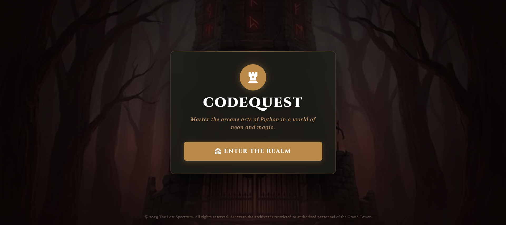  
**ภาพที่ 1** หน้าแรกของเว็บแอปพลิเคชัน

**คำอธิบาย:** หน้าแรกของเว็บแอปพลิเคชัน The Lost Spectrum แสดงชื่อเกม แนวคิดหลักของเกม และปุ่ม `ENTER THE REALM` สำหรับให้ผู้ใช้งานกดเข้าสู่หน้าเข้าสู่ระบบเพื่อเริ่มต้นการผจญภัย

---

### 2. หน้าสมัครสมาชิก

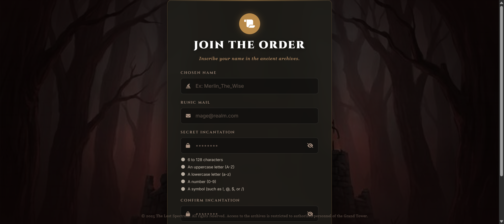  
**ภาพที่ 2** หน้าสมัครสมาชิก

**คำอธิบาย:** หน้าสมัครสมาชิกสำหรับผู้ใช้งานใหม่ ประกอบด้วยช่องกรอกชื่อผู้ใช้ (Username) อีเมล (Email) รหัสผ่าน (Password) และยืนยันรหัสผ่าน (Confirm Password) เมื่อกดสมัครสมาชิก ระบบจะจัดเก็บรหัสผ่านในรูปแบบแฮชลงฐานข้อมูลและส่งลิงก์ยืนยันตัวตนไปยังอีเมลของผู้ใช้

---

### 3. หน้าเข้าสู่ระบบ

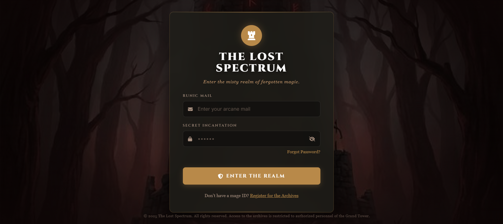  
**ภาพที่ 3** หน้าเข้าสู่ระบบ

**คำอธิบาย:** หน้าเข้าสู่ระบบให้ผู้ใช้งานกรอกอีเมลและรหัสผ่านเพื่อยืนยันตัวตนเข้าใช้งานระบบ โดยมีปุ่มเปิด/ปิดการแสดงรหัสผ่าน ลิงก์ไปยังหน้าขอรีเซ็ตรหัสผ่าน (`Forgot Password?`) และลิงก์ไปยังหน้าสมัครสมาชิกสำหรับผู้ที่ยังไม่มีบัญชี

---

### 4. หน้าขอรีเซ็ตรหัสผ่าน

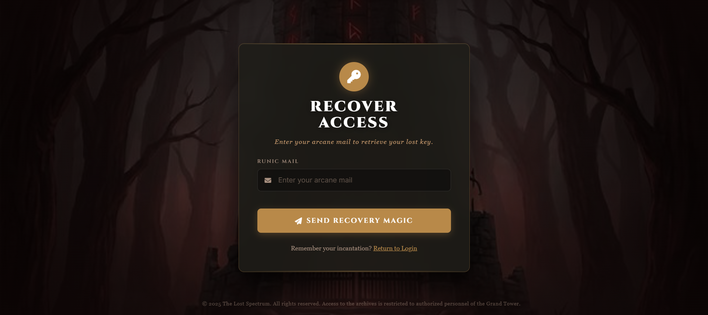  
**ภาพที่ 4** หน้าขอรีเซ็ตรหัสผ่าน

**คำอธิบาย:** หน้าขอรีเซ็ตรหัสผ่านสำหรับผู้ใช้งานที่ลืมรหัสผ่าน โดยผู้ใช้สามารถกรอกอีเมลที่ใช้สมัครสมาชิกเพื่อให้ระบบสร้างโทเคนและส่งลิงก์สำหรับตั้งรหัสผ่านใหม่กลับไปยังอีเมล

---

### 5. หน้าจอฉากเนื้อเรื่องเปิดเกม (Prologue)

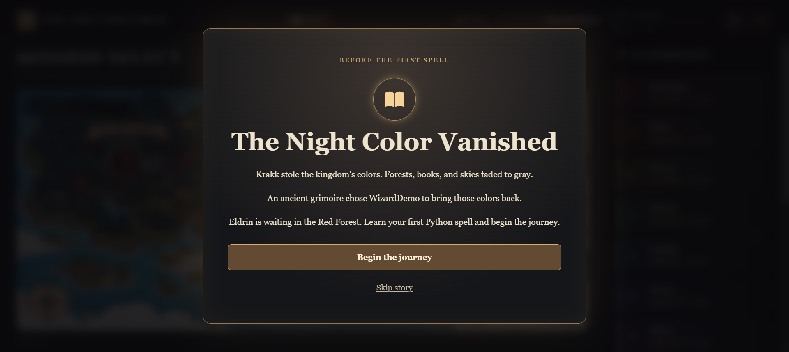  
**ภาพที่ 5** หน้าจอฉากเนื้อเรื่องเปิดเกม

**คำอธิบาย:** หน้าจอแสดงฉากเนื้อเรื่องเปิดเกม (Prologue Story Scene) เล่าที่มาของโลกแห่งสีสันที่ถูกจอมเวท Krakk ช่วงชิงไป เพื่อสร้างแรงจูงใจก่อนเริ่มเรียนรู้ โดยผู้เล่นสามารถกดอ่านทีละบทหรือกดข้ามได้

---

### 6. หน้าจอแนะนำวิธีการเล่นครั้งแรก (Onboarding Walkthrough)

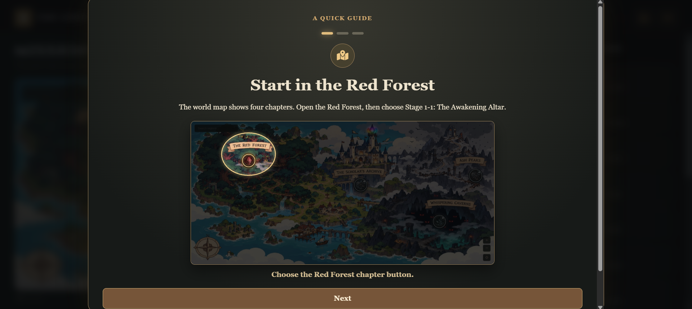  
**ภาพที่ 6** หน้าจอแนะนำวิธีการเล่นครั้งแรก

**คำอธิบาย:** หน้าต่างแนะนำวิธีการเล่นสำหรับผู้เล่นใหม่ อธิบายขั้นตอนการอ่านโจทย์ การเปิดสมุดคู่มือ การเขียนโค้ดภาษา Python และการสั่งรันโค้ดเพื่อควบคุมตัวละคร

---

### 7. หน้าแผนที่โลกและกระดานอันดับผู้เล่น (Dashboard)

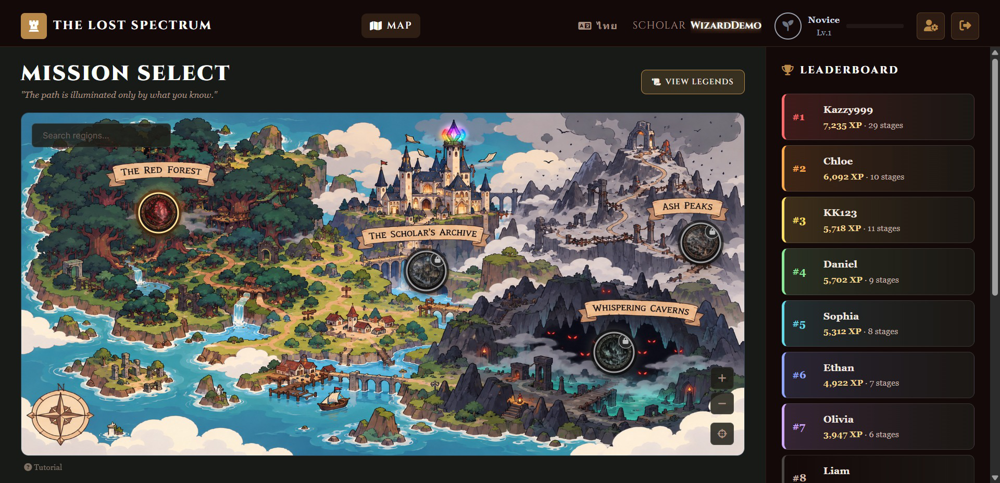  
**ภาพที่ 7** หน้าแผนที่โลกและกระดานอันดับผู้เล่น

**คำอธิบาย:** หน้าหลักของเกม (Dashboard) ประกอบด้วย
1. **แถบเมนูด้านบน:** แสดงชื่อผู้ใช้ ระดับเลเวล แถบ XP ปุ่มสลับภาษาไทย/อังกฤษ ปุ่มเข้าสู่หน้าโปรไฟล์ และปุ่มออกจากระบบ
2. **ส่วนแผนที่โลก:** แสดงทั้ง 4 ภูมิภาคตามสถานะความก้าวหน้า (ปลดล็อกแล้ว หรือล็อกอยู่) พร้อมปุ่มซูมเข้า (`+`) ซูมออก (`-`) รีเซ็ตมุมมองแผนที่ ปุ่มดูเรื่องราวโลก (`ดูเรื่องราวโลก`) และปุ่มเปิดคู่มือวิธีเล่น (`วิธีเล่น`)
3. **กระดานอันดับ (Leaderboard) ด้านขวา:** แสดงอันดับผู้เล่นสูงสุด 20 อันดับแรกเรียงตามคะแนน XP สะสมและจำนวนด่านที่ผ่าน พร้อมแสดงอันดับของผู้เล่นปัจจุบัน

---

### 8. หน้าต่างเรื่องราวของโลกและสารบัญด่าน (World Legends)

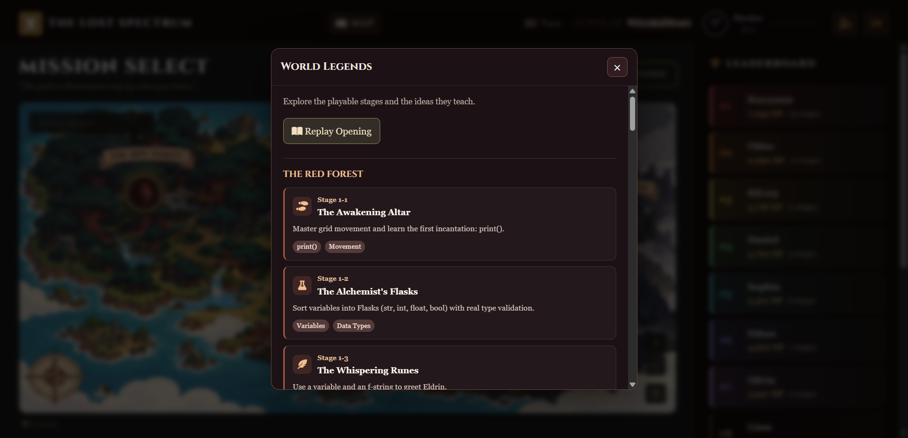  
**ภาพที่ 8** หน้าต่างเรื่องราวของโลกและสารบัญด่าน

**คำอธิบาย:** หน้าต่างแสดงภาพรวมของด่านทั้งหมดในทั้ง 4 ภูมิภาค พร้อมคำอธิบายภารกิจและแนวคิดภาษา Python ที่สอนในแต่ละด่าน รวมถึงมีปุ่มสำหรับกดรับชมฉากเปิดเรื่องซ้ำ (`ดูตอนเปิดเรื่อง`) และฉากจบซ้ำ (`ดูตอนจบ` เมื่อผ่านด่านสุดท้ายแล้ว)

---

### 9. หน้าแผนที่ภูมิภาคและลำดับด่าน (Region Map)

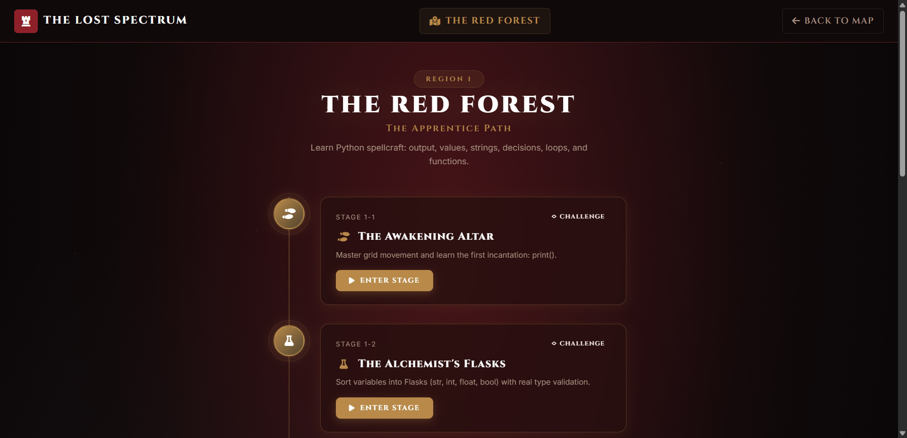  
**ภาพที่ 9** หน้าแผนที่ภูมิภาคและลำดับด่าน

**คำอธิบาย:** หน้าแสดงรายการด่านภายในภูมิภาคที่ผู้เล่นเลือกในรูปแบบไทม์ไลน์ แสดงหมายเลขด่าน ชื่อด่าน ประเภทภารกิจ คำอธิบายย่อ และสถานะของด่าน (`เข้าด่าน` หรือ `ผ่านแล้ว`) พร้อมปุ่มย้อนกลับไปยังหน้าแผนที่โลก

---

### 10. หน้าจอบทสนทนาตัวละครก่อนเริ่มด่าน (Stage Story Intro)

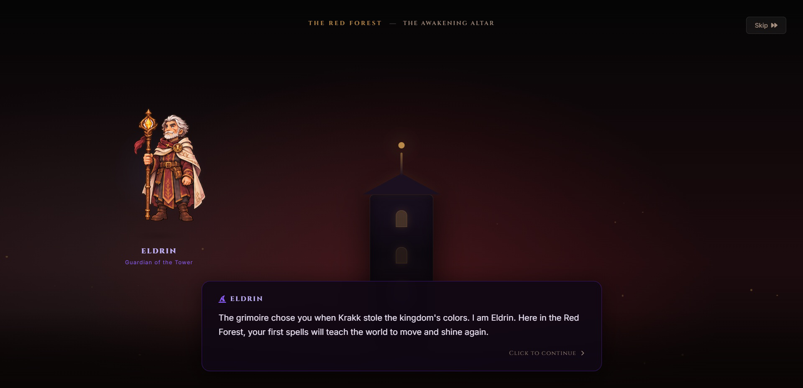  
**ภาพที่ 10** หน้าจอบทสนทนาตัวละครก่อนเริ่มด่าน

**คำอธิบาย:** หน้าจอบทสนทนาของตัวละครผู้พิทักษ์ประจำภูมิภาค (เช่น Eldrin, Loremaster Vane, Prisma) ซึ่งอธิบายเนื้อเรื่องและเชื่อมโยงแนวคิดการเขียนโปรแกรมเข้ากับภารกิจของด่าน ผู้เล่นสามารถคลิกอ่านบทสนทนาจนจบเพื่อกดเข้าสู่ด่าน หรือกดปุ่ม `Skip` ที่มุมขวาบนเพื่อข้ามไปยังหน้าเขียนโค้ดได้ทันที

---

### 11. หน้าต่างสมุดคู่มือการเรียนรู้ประจำด่าน (Grimoire)

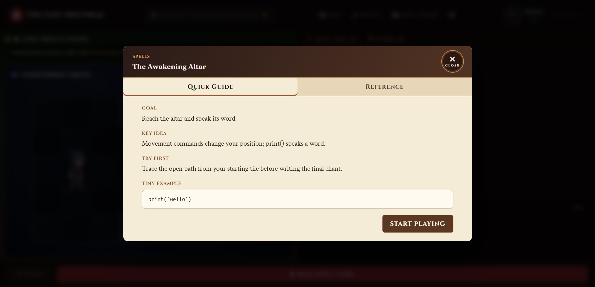  
**ภาพที่ 11** หน้าต่างสมุดคู่มือการเรียนรู้ประจำด่าน (Grimoire)

**คำอธิบาย:** สมุดคู่มือเวทมนตร์ (Grimoire) ที่เปิดแสดงแนวคิดภาษา Python คำสั่งควบคุมตัวละคร และตัวอย่างโค้ดที่เกี่ยวข้องกับด่านนั้น ๆ ผู้เล่นสามารถกดเปิดดูซ้ำได้ตลอดเวลาระหว่างเขียนโค้ดผ่านปุ่ม `คาถา (Spells)` บนแถบเมนูด้านบน

---

### 12. หน้าจอเล่นเกม สนามประลอง 2 มิติ และส่วนแก้ไขโค้ด

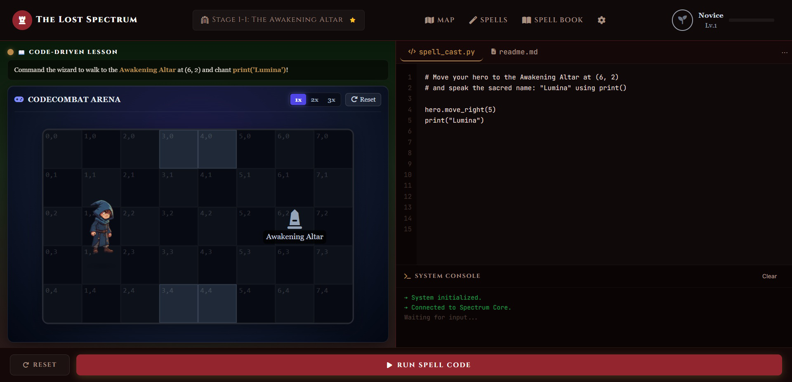  
**ภาพที่ 12** หน้าจอเล่นเกม สนามประลอง 2 มิติ และส่วนแก้ไขโค้ด

**คำอธิบาย:** หน้าจอหลักสำหรับการเล่นเกมและเขียนโปรแกรม แบ่งออกเป็น 2 ส่วนหลัก ได้แก่
1. **ส่วนแสดงผลเกมด้านซ้าย (2D CodeCombat Arena):** แสดงโจทย์เป้าหมายของด่าน ตารางพิกัด 2 มิติ ตัวละคร วัตถุหรือเป้าหมายค่าสี RGB ปุ่มปรับความเร็วแอนิเมชัน (`1x`, `2x`, `3x`) และปุ่ม `Reset` ตำแหน่งในฉาก (สำหรับด่านบอส 4-7 จะแสดงเวลานับถอยหลัง 5 นาทีด้วย)
2. **ส่วนเขียนโค้ดด้านขวา (Code Editor & System Console):** มีแท็บสลับระหว่างไฟล์โค้ด `spell_cast.py` และคำอธิบาย `readme.md` พื้นที่พิมพ์โค้ดภาษา Python คอนโซลแสดงผลลัพธ์จากการรันโค้ด ปุ่มล้างคอนโซล (`Clear`) ปุ่มคืนค่าโค้ดเริ่มต้น (`เริ่มใหม่ / RESET`) และปุ่มสั่งรันโค้ด (`รันโค้ดคาถา / RUN SPELL CODE`)

---

### 13. ส่วนแสดงคำใบ้ตามลำดับขั้นและการแจ้งเตือนข้อผิดพลาด

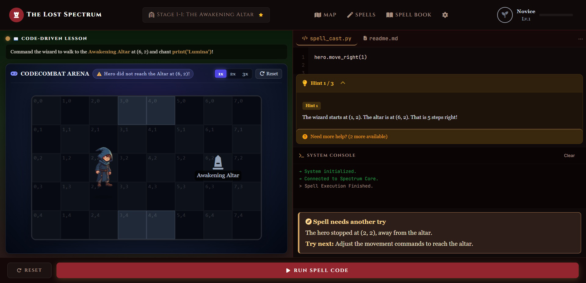  
**ภาพที่ 13** ส่วนแสดงคำใบ้ตามลำดับขั้นและการแจ้งเตือนข้อผิดพลาด

**คำอธิบาย:** เมื่อผู้เล่นรันโค้ดแล้วเกิดข้อผิดพลาดหรือยังไม่ผ่านเงื่อนไขของด่าน ระบบจะแปลงข้อผิดพลาดทางเทคนิคเป็นคำแนะนำที่เข้าใจง่าย และแสดงแถบคำใบ้ (Hint Panel) ซึ่งผู้เล่นสามารถกดขอคำใบ้เพิ่มเติมได้สูงสุด 3 ระดับตามลำดับความละเอียด

---

### 14. หน้าต่างหนังสือคาถาที่ปลดล็อกแล้ว (Spell Book)

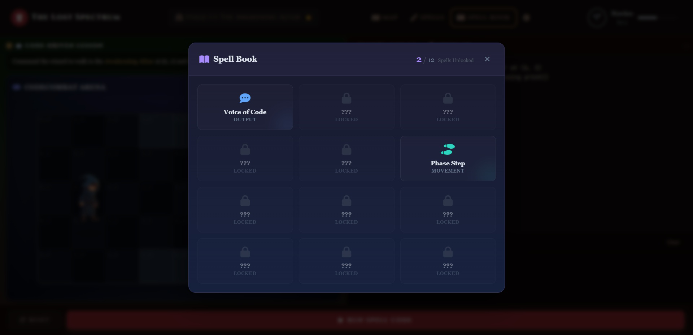  
**ภาพที่ 14** หน้าต่างหนังสือคาถาที่ปลดล็อกแล้ว (Spell Book)

**คำอธิบาย:** หน้าต่างรวบรวมคาถาภาษา Python ทั้ง 12 บทที่ผู้เล่นปลดล็อกจากการผ่านด่านต่าง ๆ เมื่อคลิกที่การ์ดคาถาที่ปลดล็อกแล้ว ระบบจะแสดงคำอธิบายหลักการ ตัวอย่างโค้ด และแนวทางการนำไปใช้งานในเกม

---

### 15. หน้าจอสรุปผลเมื่อผ่านด่านและคะแนน XP ที่ได้รับ

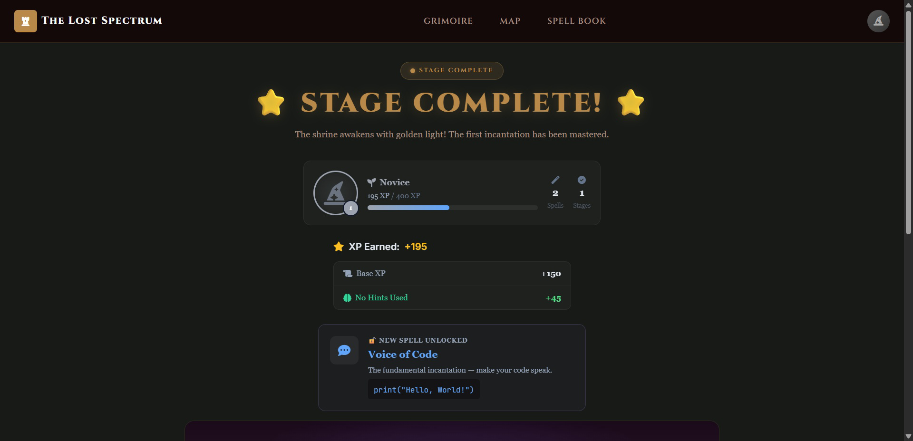  
**ภาพที่ 15** หน้าจอสรุปผลเมื่อผ่านด่านและคะแนน XP ที่ได้รับ

**คำอธิบาย:** หน้าจอสรุปผลเมื่อผู้เล่นแก้โจทย์ผ่านด่านสำเร็จ แสดงระดับเลเวลและแถบ XP ของผู้เล่น รายละเอียดคะแนน XP ที่ได้รับ (XP พื้นฐาน โบนัสผ่านด่านในครั้งแรก และโบนัสไม่ใช้คำใบ้) คาถาหรือทักษะใหม่ที่ปลดล็อก พร้อมปุ่ม `เล่นด่านนี้อีกครั้ง (Replay Level)` และปุ่ม `ไปต่อ (Continue Journey)` เพื่อเข้าสู่ด่านถัดไป

---

### 16. หน้าโปรไฟล์ผู้เล่นและประวัติการเล่นรายด่าน

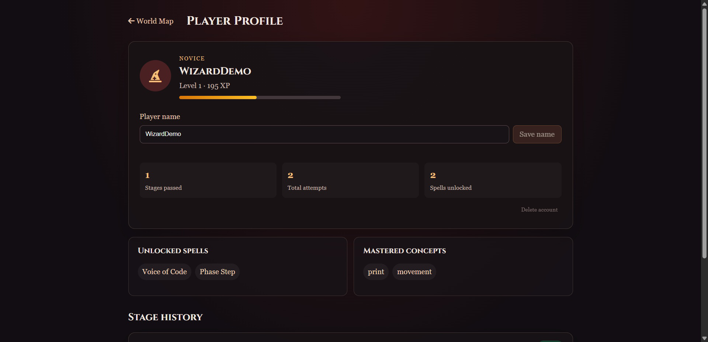  
**ภาพที่ 16** หน้าโปรไฟล์ผู้เล่นและประวัติการเล่นรายด่าน

**คำอธิบาย:** หน้าโปรไฟล์ของผู้เล่น แสดงระดับเลเวล ฉายา คะแนน XP สะสม สถิติรวม (จำนวนด่านที่ผ่าน จำนวนครั้งที่ส่งคำตอบ และจำนวนคาถาที่ปลดล็อก) ฟอร์มสำหรับแก้ไขชื่อผู้ใช้ รายการคาถาและแนวคิดที่เรียนรู้แล้ว รวมถึงตารางประวัติการเล่นรายด่าน (แสดงสถานะ จำนวนครั้งที่ลอง วันที่ผ่าน XP ที่ได้รับ และเวลาเฉลี่ยในการรัน) พร้อมปุ่มกดกลับเข้าไปเล่นด่านนั้นซ้ำได้ทันที

---

### 17. หน้าต่างยืนยันการลบบัญชีผู้ใช้ถาวร

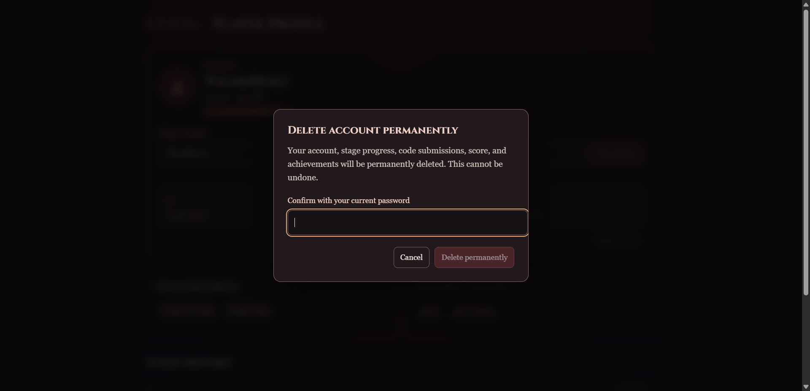  
**ภาพที่ 17** หน้าต่างยืนยันการลบบัญชีผู้ใช้ถาวร

**คำอธิบาย:** หน้าต่างยืนยันการลบบัญชีผู้ใช้ถาวร ซึ่งกำหนดให้ผู้ใช้ต้องกรอกรหัสผ่านปัจจุบันเพื่อยืนยันตัวตนก่อนลบข้อมูลบัญชี ความก้าวหน้า ประวัติการส่งโค้ด และคะแนนทั้งหมดออกจากฐานข้อมูล

